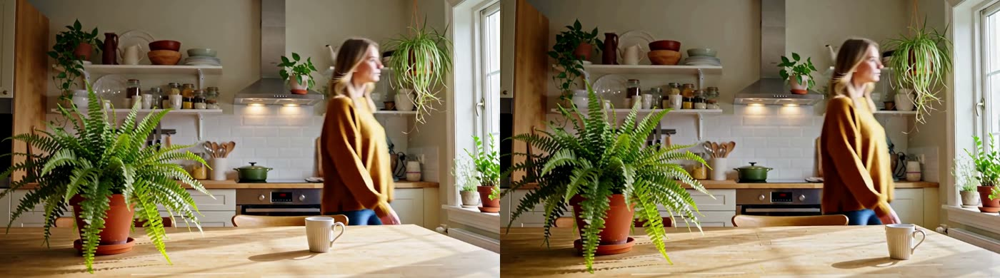
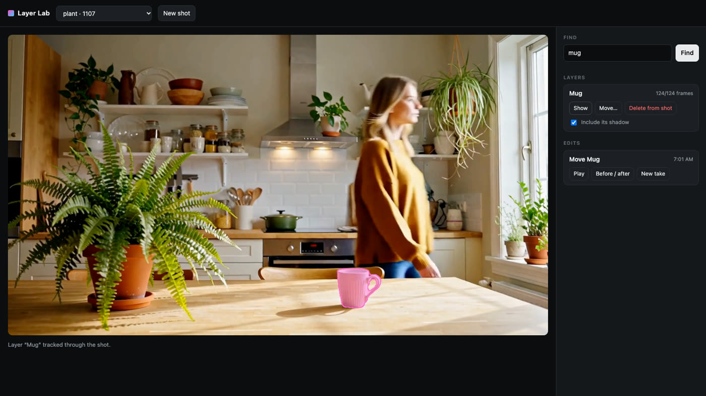
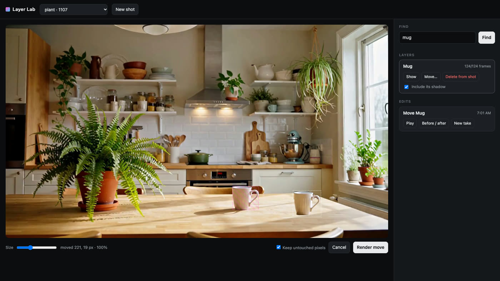
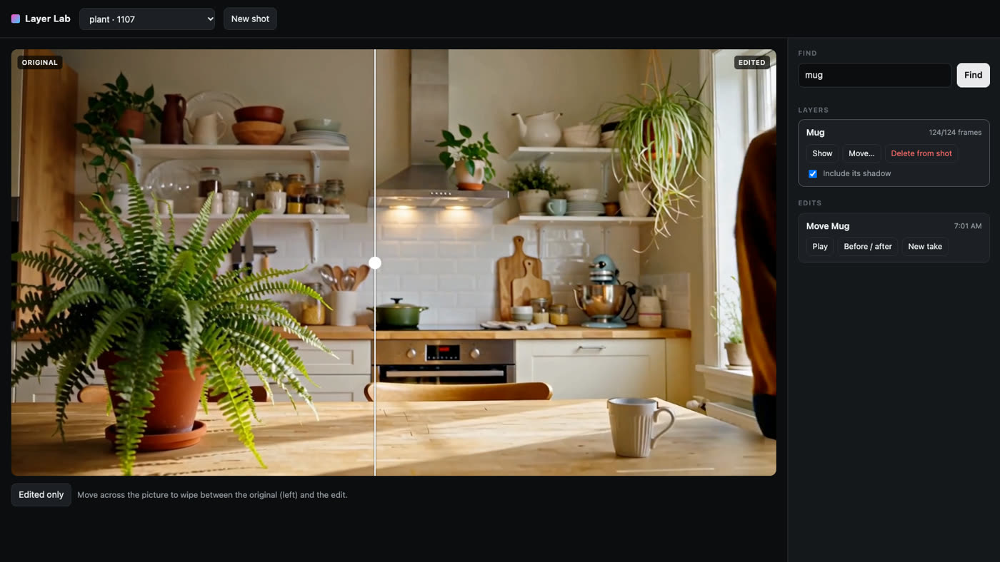
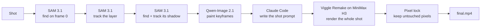
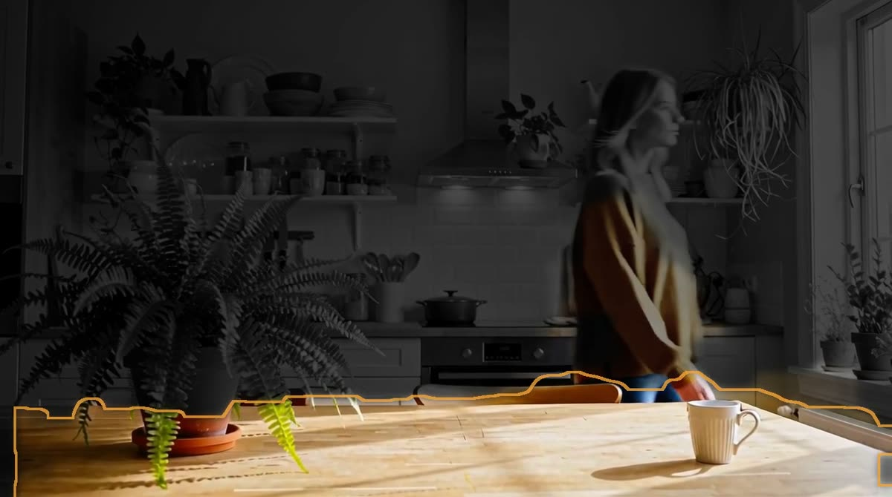

# Layer Lab

Point at something in a finished video shot and **delete it** or **move it**, shadow included. The camera move, the
people walking through the shot, the light and everything you didn't touch stay as they were.

Layer Lab is a small web app and engine that runs on an NVIDIA DGX Spark next to
[Imagination Studio](https://github.com/drowzeys/Imagination-Studio-by-keys-Wasserman). It chains open models:
SAM 3.1 to find and track the object, Qwen-Image 2.1 to paint keyframes, Claude Code to write the shot description,
and Viggle Remake on MiniMax H3 to render the edited shot. A final step puts the original pixels back everywhere
the edit didn't need to change.



*Left: the source shot. Right: the same frame after "Move Mug". The camera keeps pushing in and the woman keeps
walking; only the mug and its shadow changed place.*

---

## Contents

- [What it does](#what-it-does)
- [How it works](#how-it-works)
- [Requirements](#requirements)
- [Install](#install)
- [Run](#run)
- [Using the editor](#using-the-editor)
- [Configuration](#configuration)
- [Project files](#project-files)
- [HTTP API](#http-api)
- [Speed](#speed)
- [Limits and tips](#limits-and-tips)
- [Troubleshooting](#troubleshooting)
- [Models and licenses](#models-and-licenses)
- [Credits](#credits)

---

## What it does

1. **New shot.** Pick an Imagination Studio render or drop in any clip (up to 14.3 s; it is converted to 24 fps
   with its size rounded down to a multiple of 32).
2. **Find.** Type what you are after: `mug`, `the man in the white shirt`, `potted plant, vase`. SAM 3.1 highlights
   every match on the first frame; click the ones that belong together.
3. **Make layer.** The picked mask is tracked through every frame of the shot. The layer card shows how many frames
   it is in, and **Show** plays the tracked mask over the shot.
4. **Edit the layer:**
   - **Delete from shot**: the object (and, optionally, its shadow) is removed, and what was behind it is filled in.
   - **Move…**: drag the cut-out to a new spot, use the size slider or scroll wheel to scale it, then **Render move**.
     The object keeps its own motion along the shifted path, and its real shadow moves with it.
5. **Check it.** **Play** shows the result; **Before / after** gives a wipe you drag across the picture.
   **New take** renders the same edit again with a new seed.

| Find and make a layer | Move it | Before / after |
|---|---|---|
|  |  |  |

---

## How it works



The engine is `engine/pipeline.py`. Each step, in order:

### 1. Find (`pipeline.find`, `engine/sam.py`)

SAM 3.1 (ComfyUI's native SAM 3 model, run in-process, not through a workflow) detects the text on the shot's first
frame. Comma-separated phrases are searched together, up to 12 instances each. Matches below 0.4 confidence are
dropped, and so is any mask that is 85% inside a better-scoring one (a part of an object already listed). Up to 12
candidates come back, each with a mask PNG for the editor's highlights.

### 2. Track (`pipeline.track`)

The masks you picked are merged and handed to SAM 3.1's video tracker as the first-frame mask (tracking only, with no
re-detection), giving one mask per frame. The layer is stored as packed masks, a preview video with the mask
overlaid, and a feathered cut-out of the object from frame 0, which is what you drag in Move mode.

### 3. Shadow (`pipeline.shadow_masks`)

With **Include its shadow** on, SAM 3.1 looks for `shadow` on the first frame (confidence 0.3 and up). The shadow
mask that overlaps the object's mask grown by 60 px the most (at least 200 px) is taken and tracked through the shot
the same way. If nothing qualifies, the edit goes ahead without a shadow.

### 4. Keyframes (`pipeline.run_edit`, `clean_plate`, `moved_key`)

The edit is pinned at a few frames of the shot:

- the first and last frames where the object is visible (just one if they are 30 frames apart or less);
- for a move, only frames where the object is wholly inside the picture, because it gets cut out and pasted;
- for a move where the object travels more than 8% of the frame width (over 60+ frames), four frames: start,
  one third, two thirds and end. Otherwise the render tends to drift back to the object's old path.

At each pinned frame:

- **Clean plate.** Qwen-Image 2.1 edit (Imagination Studio's `spark/spark_edit.py`) is asked to remove the object
  and its shadow and fill in what is behind it. Only the area inside the object's mask, grown by 22 px and
  feathered, is taken from the edit. Outside that feathered area the keyframe is the source frame, untouched.
- **Moved object** (Move only). The object is cut from the source frame and pasted onto the clean plate at the new
  offset and scale, scaled about its base so it stays on the surface. If its shadow was found, the shadow's real
  darkening (source frame ÷ clean plate, inside the shadow mask) is moved with it, so it keeps its exact shape and
  softness. If no shadow was found, a second Qwen-Image pass adds a contact shadow, blended in only in a band around
  the new spot.


*Frame 0 of the mug edit: the source, the clean plate (mug and shadow removed), and the keyframe with the mug and
its shadow at the new spot.*

### 5. The prompt (`engine/prompter.py`)

Viggle Remake reads MiniMax H3's six-section prompt (`subject_definitions`, `summary`, `retention_analysis`,
`detailed_description`, `overall_soundscape`, `non_diegetic_music`). Claude Code runs headless (`claude -p`, with
only its Read tool) and looks at three stills of the source (first, middle, last) and at the keyframes. It then
writes that prompt in the format of Viggle's own example. It describes the scene literally, defines the object as a
subject with its old and new position, marks everything else as preserved frame for frame, and times the shot
against the pinned keyframes.

### 6. Render (`engine/viggle.py`)

The source is padded to a length H3 accepts (17n + 5 frames, 90 to 345) by holding its last frame. Viggle Remake's
`edit` model (the int8 file with its LoRA already merged) renders the whole shot through the Studio's ComfyUI API,
with the keyframes pinned at their frame numbers. Shots up to 192 frames render at a short edge of 736 px
(1280×736 for 16:9), longer ones at 480. Before the render, the Studio's resident QA server is stopped so H3 fits
under the Studio's memory guard, and ComfyUI is started with the Studio's `spark/comfy.sh` if it isn't running.

### 7. Pixel lock (`engine/lock.py`)

H3 redraws the whole frame, at its own canvas size. Layer Lab:

1. undoes the render's centre crop and scales it back onto the source frame size;
2. builds an edit region per frame: the object's filled outline grown by 16 px, plus its shadow grown by 14 px.
   For a move, it adds the object where the render actually put it (SAM 3.1 tracks it in the render, since a camera
   move shifts it) and the moved shadow;
3. colour-matches the render to the source on a ring around the region (per-channel gain and offset, gain held to
   0.85–1.15);
4. blends the render in only inside the region, with an 18 px feather. Outside the region and its feathered edge,
   every pixel is the source.



*What changed in the mug edit (in colour): the edit regions and their feathered edges. The rest of the frame is the
original footage.*

You can turn this off per edit (**Keep untouched pixels** in Move mode) to get the raw render on the source canvas.

### The app (`app/server.py`, `app/index.html`)

A FastAPI server with one background worker. Track and edit jobs run one at a time, in order. **Find** runs right
away but refuses (HTTP 409) while a job holds the GPU. Jobs also wait while any process matching
`LAYERLAB_BUSY_PATTERN` is running (by default the Studio's own video and swap jobs), so Layer Lab and the Studio
don't fight over memory. The front end is one HTML file with no build step.

---

## Requirements

- **Hardware:** tested on an NVIDIA DGX Spark (GB10, 128 GB unified memory). H3 is large: an edit holds the int8
  video model, the int8 text encoder and the VAEs at once.
- **Imagination Studio**, installed and working, with:
  - its ComfyUI (a recent one with the native SAM 3 nodes, `comfy_extras/nodes_sam3.py`);
  - SAM 3.1 (`sam3.1_multiplex_fp16.safetensors`, which the Studio's swap setup installs:
    `bash spark/setup-swap.sh`);
  - MiniMax H3's int8 text encoder and VAEs from the Studio's H3 install
    (`qwen3vl_32b_minimax_h3_int8_convrot`, `minimax_h3_video_vae_fp16`, `minimax_h3_audio_vae_fp32`);
  - its picture edit (`spark/spark_edit.py` with Qwen-Image 2.1).
- **Viggle Remake** (about 42 GB). `scripts/install_viggle.sh` fetches and wires it.
- **Claude Code**, installed and signed in on the same machine (`claude -p` must work there).
- `ffmpeg`, and [`uv`](https://docs.astral.sh/uv/) for the setup script.

---

## Install

On the Spark, as the user that runs Imagination Studio:

```bash
git clone https://github.com/joshdaws/layer-lab.git
cd layer-lab

bash scripts/setup.sh           # Python env in ~/layerlab/venv: CUDA PyTorch + ComfyUI's requirements + the app's
bash scripts/install_viggle.sh  # Viggle Remake int8 models, node pack and workflows, linked into the Studio
bash ~/Imagination-Studio-by-keys-Wasserman/spark/comfy.sh stop   # so ComfyUI picks up the new node pack
~/layerlab/venv/bin/python scripts/check.py                      # every line should say ok
```

`setup.sh` uses CUDA 13.0 PyTorch wheels (what the GB10 needs). On another GPU, set `TORCH_INDEX`, for example
`TORCH_INDEX=https://download.pytorch.org/whl/cu128 bash scripts/setup.sh`.

---

## Run

```bash
bash scripts/run.sh        # http://127.0.0.1:7890
```

It listens on localhost only. To reach it from another device, put it behind something you control, for example
Tailscale:

```bash
tailscale serve --bg --set-path /layerlab http://127.0.0.1:7890
```

The front end uses relative URLs, so it works under a path prefix like `/layerlab/` as well as at `/`. There is no
login: anyone who can reach the port can use the GPU and see the projects, so keep it on a private network.

To keep it running, start it in `tmux` (`tmux new -d -s layerlab bash scripts/run.sh`) or a systemd user service.

---

## Using the editor

- **Pick what belongs together.** A find often returns parts (a pot and the plant in it, a person and their bag).
  Click every highlight or chip that should move as one, name the layer in the box next to **Make layer** (it starts
  as your search text), then make it. The name goes into the prompt ("Move the mug…"), so a plain noun works best.
- **Shadows.** A move always carries the object's shadow. For **Delete from shot**, leave **Include its shadow** on for
  objects on a lit surface; deleting a mug without its shadow leaves a floating shadow behind.
- **Moving.** Drag the dashed cut-out; the readout shows the offset in source pixels and the scale. The pink hatched
  box is where the object was. Scaling happens about the object's base, so it stays on the surface it sits on.
- **Takes.** H3 renders vary with the seed. If a result is close but not right, **New take** re-renders the same edit
  with a new seed. A failed job offers **Try again (new seed)**.

---

## Configuration

Everything is an environment variable with a default that matches Imagination Studio's layout
(`engine/config.py`). Where the Studio has its own variable (`PREFIX`, `SPARK_MODELS`, `SPARK_COMFY_PORT`,
`STUDIO_HOME`), Layer Lab reads the same one.

| Variable | Default | What it is |
|---|---|---|
| `LAYERLAB_HOME` | `~/layerlab` | Layer Lab's folder: `projects/`, extra clips in `shots/`, and `venv/` |
| `STUDIO_DIR` | `~/Imagination-Studio-by-keys-Wasserman` | The Studio checkout (for `spark/spark_edit.py`, `spark/comfy.sh`) |
| `PREFIX` | `~/.local/opt/tensorfold-studio` | The Studio's install prefix (its ComfyUI and Python env) |
| `STUDIO_PY` | `$PREFIX/venv/bin/python` | Python that runs the Studio's picture edit |
| `COMFYUI_DIR` | `$PREFIX/ComfyUI` | ComfyUI (imported in-process for SAM 3.1; also its `input/` and `output/`) |
| `SPARK_MODELS` | `~/spark-studio-models` | The Studio's model folder |
| `STUDIO_HOME` / `STUDIO_RENDERS` | `~/ImaginationStudio` / `$STUDIO_HOME/renders` | Where Studio renders are listed from |
| `SPARK_COMFY_PORT` / `COMFY_URL` | `8190` / `http://127.0.0.1:8190` | The ComfyUI server Viggle renders on |
| `SAM_CKPT` | `$SPARK_MODELS/Workflows-Comfy/checkpoints/sam3.1_multiplex_fp16.safetensors` | SAM 3.1 checkpoint |
| `VIGGLE_DIR` | `$SPARK_MODELS/Viggle-Remake` | Viggle Remake download (workflows, int8 models, node pack) |
| `VIGGLE_TEXT_ENCODER` | `qwen3vl_32b_minimax_h3_int8_convrot.safetensors` | H3 text encoder name in ComfyUI |
| `CLAUDE_BIN` / `CLAUDE_MODEL` | `claude` on PATH, else `~/.local/bin/claude` / `opus` | Claude Code for the prompt |
| `LAYERLAB_FREE_CMD` | `pkill -f '[t]ensorfold-native serve'` | Run before each render to free memory; set to empty to skip |
| `LAYERLAB_BUSY_PATTERN` | `spark_generate.py\|spark_swap.py` | Jobs wait while a matching process runs; empty = never wait |
| `HOST` / `PORT` | `127.0.0.1` / `7890` | Where `scripts/run.sh` listens |
| `LAYERLAB_VENV` | `$LAYERLAB_HOME/venv` | The env `setup.sh` makes and `run.sh` uses |

---

## Project files

Each shot is a folder in `$LAYERLAB_HOME/projects/<id>/`:

```
meta.json            title, size, frame count
source.mp4           the shot at 24 fps (what every step reads)
poster.jpg / .png    first frame
finds/<fid>/         one Find: N.png / N.npy masks, find.json (text, candidates, scores, boxes)
objects/<oid>/       one layer: masks.npz (packed per-frame masks), track.mp4, cutout.png, object.json
edits/<eid>/         one edit:
  edit.json          op, offset, scale, options, status, start and finish times
  k<frame>_src.png, k<frame>_clean.png, k<frame>_comp.png, key<frame>.png   keyframes
  orig_<frame>.png   stills given to Claude
  prompt.txt         the prompt Claude wrote
  src_padded.mp4     the shot padded to 17n+5 frames
  gen.mp4            Viggle Remake's raw render (its own canvas)
  final.mp4          the result on the source canvas, pixel-locked
  compare.mp4        source and result side by side
```

---

## HTTP API

| Method and path | Body | Does |
|---|---|---|
| `GET /api/projects` | | Lists shots |
| `GET /api/projects/{pid}` | | A shot with its layers and edits |
| `GET /api/studio-renders` | | Recent Studio renders and clips in `shots/` |
| `POST /api/projects/from-path` | `{"path", "title"?}` | New shot from a Studio render or `shots/` clip |
| `POST /api/projects/upload` | multipart `file` | New shot from an upload |
| `POST /api/projects/{pid}/find` | `{"text", "frame"?}` | Runs SAM 3.1, returns candidates (409 while a job holds the GPU) |
| `POST /api/projects/{pid}/track` | `{"fid", "picks", "label"}` | Queues a track job (makes a layer) |
| `POST /api/projects/{pid}/edit` | `{"oid", "op": "delete"\|"move", "dx"?, "dy"?, "scale"?, "with_shadow"?, "lock"?, "seed"?}` | Queues an edit |
| `GET /api/jobs` | | The 30 most recent jobs with their stage and log |
| `POST /api/jobs/{jid}/cancel` | | Cancels a queued job |
| `GET /files/{pid}/{path}` | | Serves a file from a shot's folder |

---

## Speed

Measured on one DGX Spark, for the mug move shown above: 124 frames at 1376×768, rendered at 1280×736.

| Step | Time |
|---|---|
| Whole edit: shadow, 2 keyframes, prompt, render, pixel lock | 853 s (about 14 minutes) |
| Of that, the H3 render | about 10 minutes for 5 s at 1280×736 |

Find and Make layer are quick next to an edit (they are SAM 3.1 passes on the same GPU). Shots over 192 frames
render at a short edge of 480, which is faster but softer.

---

## Limits and tips

- **One layer per edit.** To delete two things, delete one, then make a new shot from the result (download it into
  `shots/`) and delete the other.
- **Length:** up to 14.3 s per shot (H3's 345-frame window at 24 fps).
- **Keyframes come from the first and last frames the object is visible in.** An object that enters late or is
  heavily covered may need a few takes.
- **Shadow finding is a heuristic** (the text "shadow" near the object). Hard shadows on a plain surface work well;
  soft, scattered or multiple shadows less so.
- **Large moves across a moving camera** get four keyframes automatically. Very large moves, into a new depth or
  behind other objects, are the hardest case.
- **The render is a generation, not a copy.** The pixel lock keeps the rest of the frame exact, but inside the edit
  region H3 can change texture or detail slightly. **Before / after** shows exactly what changed.

---

## Troubleshooting

- **A job sits at "waiting: another GPU job is running".** A process matching `LAYERLAB_BUSY_PATTERN` is running.
  Let it finish, or change the pattern.
- **ComfyUI stops partway through a render.** The Studio's memory guard stopped it for running low on memory. Make
  sure nothing else large is loaded (the Studio's QA server is stopped by `LAYERLAB_FREE_CMD`), and avoid running
  Studio jobs at the same time.
- **"ComfyUI did not come up".** Layer Lab starts ComfyUI with the Studio's `spark/comfy.sh start`. Run that by hand
  and look at the Studio's ComfyUI log.
- **The render's node is unknown** (`RemakeConditioning`). The Viggle node pack isn't loaded. Run
  `scripts/install_viggle.sh`, then restart ComfyUI.
- **The prompt step fails.** Run `claude -p "hello"` as the same user; Claude Code must be installed and signed in.
- **`python scripts/check.py`** shows what's missing and where it looked.

---

## Models and licenses

Layer Lab's own code is MIT licensed ([LICENSE](LICENSE)). It downloads no weights itself except Viggle Remake
(through `scripts/install_viggle.sh`), and ships none. Each model has its own terms. Read them before you use it,
especially for commercial work and for where you are allowed to use it.

| Model | Used for | Terms |
|---|---|---|
| [SAM 3.1](https://huggingface.co/facebook/sam3.1) (Meta) | find, track, shadow | SAM License |
| [Qwen-Image 2.1](https://huggingface.co/Qwen) (via Imagination Studio) | keyframes | see its model card |
| [MiniMax H3](https://huggingface.co/MiniMaxAI/MiniMax-H3) | the video model | MiniMax H3 Community License |
| [Viggle Remake](https://huggingface.co/Viggle/Viggle-Remake) | H3 edit LoRA (int8 merged) | MiniMax H3 Community License (model), Viggle's code license (node pack) |
| [Claude Code](https://docs.anthropic.com/en/docs/claude-code) (Anthropic) | writes the prompt | Anthropic's terms |

---

## Credits

- [Imagination Studio](https://github.com/drowzeys/Imagination-Studio-by-keys-Wasserman) by Keys and Sam Wasserman:
  the DGX Spark install, ComfyUI setup, memory guard and picture edit that Layer Lab builds on.
- [Viggle Remake](https://huggingface.co/Viggle/Viggle-Remake) by Viggle: the H3 edit model, its ComfyUI nodes and
  the six-section prompt format.
- MiniMax (H3), Meta (SAM 3.1), Alibaba's Qwen team (Qwen-Image), Anthropic (Claude Code).

Built by Josh Daws.
